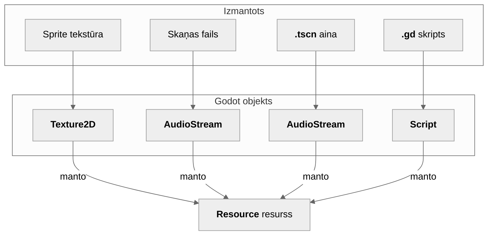

---
{"dg-publish":true,"permalink":"/notes/godot-resursi/","tags":["note"],"dg-note-properties":{"categories":["[[Categories/Projects]]"],"references":["[[Pulciņa nodarbības/14. Pulciņa nodarbība]]"],"tags":["note"],"created":"2026-11-05","cssclasses":null}}
---

[[Pulciņa nodarbības/14. Pulciņa nodarbība\|Atpakaļ]]

---

# Godot resursi un saglabāšanas/ielādes sistēma

> Šajā materiālā vārds **resurss** vienmēr nozīmē **Godot Resource** objektu. Spēles failus (attēlus, skaņas, 3D modeļus u. c.) saucam par [[Notes/Pulciņā izmantotās terminoloģijas vārdnīca\|asetiem]], lai tos nesajauktu.

---

## Kas ir resurss (**Resource**)?

### Definīcija
**Resurss** ir Godot objekts, kura uzdevums ir **glabāt datus**. Tas nav [[Notes/Iepazīšanās ar Godot dzini#Mezgli\|Node (mezgls)]] - tas neatrodās [[Notes/Iepazīšanās ar Godot dzini#Ainas\|ainā]], tam nav `_process` un tam nav pozīcijas. Tas ir tikai vērtību konteiners, kuru Godot prot **saglabāt failā un ielādēt atpakaļ**.

**Resurss** ir fails ar paplašinājumu `.tres` vai `.res` 
- `.tres` - ja saglabā Godot, sadarbojas labi ar versiju kontroli. Pārskatāmāks, taču lēnāks.
- `.res` - ja saglabā eksportētā spēlē. Ātrāks, nav tik pārskatāms.

#### Kā izskatās `.tres` fails

>[!Piemers] 
>Saglabāts `SaveData` resurss ([[Notes/Godot resursi#Pilnā saglabāšanas struktūra\|skripts redzams šeit]]), kurā ir `PlayerData` un `SettingsData`. Šo failu var atvērt jebkurā teksta redaktorā (Notepad, VS Code):

```
[gd_resource type="Resource" script_class="SaveData" load_steps=4 format=3]

[ext_resource type="Script" path="res://resources/save_data.gd" id="1_a1b2c"]
[ext_resource type="Script" path="res://resources/player_data.gd" id="2_d3e4f"]
[ext_resource type="Script" path="res://resources/settings_data.gd" id="3_g5h6i"]

[sub_resource type="Resource" id="Resource_p1x2a"]
script = ExtResource("2_d3e4f")
max_hp = 150
hp = 42
projectile_count = 3
position = Vector2(240, 128)

[sub_resource type="Resource" id="Resource_s9k3b"]
script = ExtResource("3_g5h6i")
music_volume = 0.5

[resource]
script = ExtResource("1_a1b2c")
player = SubResource("Resource_p1x2a")
settings = SubResource("Resource_s9k3b")
current_level = "level_2"
```

### Jūs resursus jau izmantojat, to neapzinoties


>**Asets** ir fails jūsu projektā (piemēram, `.png`), bet **resurss** ir Godot objekts, kas šo failu ielādē un ar to strādā. Tāpēc, piemēram, `.png` asetu Godot ielādē kā `Texture2D` **resursu**.

>Jūs varat izveidot **savus resursu tipus** ar saviem mainīgajiem un fukcijām, un Godot tos serializēs (pārvērtīs failā).

### Mezgli pret resursiem

|                                                    | Mezgls                      | Resurss                            |
| -------------------------------------------------- | --------------------------- | ---------------------------------- |
| Atrodas [[Notes/Iepazīšanās ar Godot dzini#Ainas\|ainā]] | Jā                          | Nē                                 |
| Ir `_ready`, `_process`                            | Jā                          | Nē                                 |
| Mērķis                                             | Uzvedība un klātbūtne spēlē | Datu glabāšana un koplietošana     |
| Var tikt saglabāts failā pats par sevi             | Tikai kā daļa no ainas      | Jā, tieši                          |
| Atmiņas atbrīvošana                                | Kad izņemts no koka         | Kad uz to vairs neviens neatsaucas |

>[!Piemers]
>Spēlētāja [[Notes/Iepazīšanās ar Godot dzini#Mezgli\|mezgls]] skrien un šaudās. Spēlētāja dzīvības, maksimālās dzīvības un šāviņu skaits ir _dati par spēlētāju_, un šie dati pieder **resursam**.

---

## Sava resursa izveide

>Sevis veidots resurss ir **skripts**, kas papildina **resursu** objektu `extends Resource`.

```gdscript
# res://resources/player_data.gd
class_name PlayerData
extends Resource

@export var max_hp: int = 100
@export var hp: int = 100
@export var projectile_count: int = 1
@export var position: Vector2 = Vector2.ZERO
```

1. **`extends Resource`** padara šo skriptu par resursa tipu.
2. **`class_name PlayerData`** izveido klasi globāli (visa projekta ietvaros), tāpēc var rakstīt `PlayerData.new()` jeb izmantot to kā tipu. Tā arī parādās redaktora dialogā „New Resource".
3. **`@export`** norāda, ka mainīgais tiks **saglabāts**.

>**Failā tiek ierakstīti tikai `@export` mainīgie.** Parasts `var` resursā _netiek saglabāts_, un pēc ielādes tas pārvērtīsies par tā noklusējuma vērtību.

### Izveide redaktorā

**FileSystem** panelī: 
labais klikšķis => Create New => Resource... => `PlayerData` => saglabājiet kā `player_default.tres`. Tagad vērtības var mainīt inspectorā, tāpat kā [[Notes/Iepazīšanās ar Godot dzini#Mezgli\|mezglu]] īpašības. Noder **sākuma vērtībām**.

### Izveide kodā

```gdscript
var data := PlayerData.new()
data.hp = 80
```

---

## Atbalstītie datu tipi

Var saglabāt jebkuru parastu Godot vērtības tipu, ja tas ir `@export`:

| Darbojas                    | Piemēri                                                        |
| --------------------------- | -------------------------------------------------------------- |
| Pamata tipi                 | `int`, `float`, `bool`, `String`                               |
| Matemātikas tipi            | `Vector2`, `Vector3`, `Color`, `Rect2`, `Transform2D`          |
| Saraksti, masīvi, vārdnīcas | `Array`, `Array[String]`, `Dictionary`, `PackedStringArray`... |
| Citi resursi                | `@export var stats: StatsData`                                 |

| Nedarbojas labi          | Kāpēc?                                                              |
| ------------------------ | ------------------------------------------------------------------- |
| Atsauces uz **Mezgliem** | **Mezgli** pastāv tikai mezglu kokā un nesaglabā datus starp ainām. |
| `Callable`, signāli      | Nav jēgas saglabāt                                                  |
| `var` bez `@export`      | [[Notes/Godot resursi#Sava resursa izveide\|Netiek saglabāts]]            |

---

## Resursu saglabāšana un ielāde

Izmantojam divas klases - **`ResourceSaver`** un **`ResourceLoader`**:

- **`ResourceSaver.save(resource, path)`**: Saglabā resursu kā `.tres` failu norādītajā mapē ar norādīto nosaukumu.
- **`ResourceLoader.load(path)`** (vai saīsinājums `load(path)`): nolasa saglabāto failu, to ielādē.

```gdscript
# Saglabāšana
var data := PlayerData.new()
data.hp = 42
var err := ResourceSaver.save(data, "user://player.tres")
if err != OK:
    printerr("Neizdevās saglabāt!!!)

# Ielāde
var loaded := load("user://player.tres") as PlayerData
print(loaded.hp)   # 42
```

`ResourceSaver.save` atgriež `Error` kodu. `OK` = viss OK. **Vienmēr veiciet šo pārbaudi!** Neizdevušos saglabāšanu viegli nepamanīt.

### Kāpēc `user://`, nevis `res://`?

| Ceļš      | Nozīme                                                         | Vai var rakstīt?                      |
| --------- | -------------------------------------------------------------- | ------------------------------------- |
| `res://`  | Jūsu projekta mape                                             | redaktorā jā, **eksportētā spēlē nē** |
| `user://` | Atsevišķa mape katram lietotājam un projektam spēlētāja datorā | Vienmēr                               |

>[!Atceries]
>**Saglabāšanas failiem jāatrodas `user://`.** Ja saglabāsiet `res://`, liksies, ka viss strādā kā iecerēts, taču salūzīs uzreiz pēc spēles eksportēšanas.

Lai uzzinātu, kur tieši atrodas `user://`, ej uz **Project => Open User Data Folder**.

### `.tres` pret `.res`

|               | `.tres`                                  | `.res`         |
| ------------- | ---------------------------------------- | -------------- |
| Formāts       | Cilvēkam lasāms teksts                   | Binārs         |
| Izmērs/ātrums | Lielāks                                  | Mazāks, ātrāks |
| Atkļūdošana   | Viegli: atveras jebkurā teksta redaktorā | Nav lasāms     |
| Piemērots     | Mācībām un izstrādei                     | Gala versijai  |

Izstrādes laikā izmantojiet `.tres`. Failu var vienkārši atvērt un pārbaudīt, vai vērtības ir saglabātas:

```ini
[gd_resource type="Resource" script_class="PlayerData" load_steps=2 format=3]

[ext_resource type="Script" path="res://resources/player_data.gd" id="1_x7k2p"]

[resource]
script = ExtResource("1_x7k2p")
max_hp = 100
hp = 42
projectile_count = 3
position = Vector2(240, 128)
```

>Failā tiek glabāts **ceļš uz skriptiem**.

---

## Pilnā saglabāšanas struktūra

Labāk nekā saglabāt daudzus mazus failus ir izveidot **vienu saknes resursu `SaveData`**, kurā ir ligzdoti citi resursi.

```gdscript
# res://resources/save_data.gd
class_name SaveData
extends Resource

@export var version: int = 1
@export var player: PlayerData = PlayerData.new()
@export var settings: SettingsData = SettingsData.new()
@export var current_level: String = "level_1"
```

```gdscript
# res://resources/settings_data.gd
class_name SettingsData
extends Resource

@export var music_volume: float = 0.8
@export var sfx_volume: float = 1.0
```

>Saglabājot `SaveData`, automātiski tiek saglabāts viss tajā ligzdotais, vienā failā. Tas padara sistēmu vienkāršāku - **viens fails, viens saglabāšanas izsaukums, viens ielādes izsaukums.**

---

## SaveManager (**Autoload**)

Saglabāšanas sistēmai jābūt pieejamai no galvenās izvēlnes, spēlētāja, līmeņa utt. Standarta risinājums ir **[Autoload](https://docs.godotengine.org/en/stable/tutorials/scripting/singletons_autoload.html)** (globāli ielādēts skripts, kas vienmēr ir pieejams).

```gdscript
# res://save_manager.gd
extends Node

const SAVE_PATH := "user://savegame.tres"

var data: SaveData = SaveData.new()

func has_save() -> bool:
    return FileAccess.file_exists(SAVE_PATH)

func new_game() -> void:
    data = SaveData.new()

func save_game() -> void:
    var err := ResourceSaver.save(data, SAVE_PATH)
    if err != OK:
        printerr("Saglabāšana neizdevās!!!)

func load_game() -> bool:
    if not has_save():
        return false
    var loaded := ResourceLoader.load(
        SAVE_PATH) as SaveData
    if loaded == null:
        printerr("Saglabājuma fails ir bojāts vai nelasāms.")
        return false
    data = loaded
    return true
```

>[!Globalizacija]
Pataisiet to par **globālu skriptu** sadaļā **Project => Project Settings => Globals (Autoload)** ar nosaukumu `SaveManager`. Tagad jebkurš skripts varēs izmantot `SaveManager.data`, `SaveManager.save_game()` utt.


---

## Datu izmantošana spēlē

### Ieteicamā pieeja: resurss ir patiesības avots

Tā vietā, lai spēlētājam būtu savs `var hp`, HP atrodas resursā, un spēlētājs to maina vai nolasa.

**Pirms (dati atrodas mezgla skriptā):**

```gdscript
extends CharacterBody2D

var hp := 100
var projectile_count := 1

func take_damage(amount: int) -> void:
    hp -= amount
```

**Pēc (dati atrodas resursā):**

```gdscript
extends CharacterBody2D

var stats: PlayerData

func _ready() -> void:
    stats = SaveManager.data.player

func take_damage(amount: int) -> void:
    stats.hp -= amount
    if stats.hp <= 0:
        die()
```

### Integrācija galvenajā izvēlnē

```gdscript
# main_menu.gd
extends Control

@onready var continue_button: Button = %ContinueButton

func _ready() -> void:
    continue_button.disabled = not SaveManager.has_save()

func _on_new_game_pressed() -> void:
    SaveManager.new_game()
    get_tree().change_scene_to_file("res://levels/level_1.tscn")

func _on_continue_pressed() -> void:
    if SaveManager.load_game():
        get_tree().change_scene_to_file(
            "res://levels/%s.tscn" % SaveManager.data.current_level
        )
```

Process īsumā:

- **New Game** => jauns `SaveData.new()` (visas noklusējuma vērtības) => sākt spēli.
- **Continue** => `load_game()` => pāriet uz saglabāto līmeni; spēlētājs savus datus nolasa no ielādētā resursa `_ready` funkcijā.
- **Saglabāšana** => iespējams izsaukt `SaveManager.save_game()` spēlei atbilstošā veidā -  pauzes izvēlnes pogā, mainot līmeni, iziejot no spēles vai nospiežot kādu klaviatūras pogu (`F5` quicksave, `F9` quickload).

### Spēlētāja pozīcijas saglabāšana

Pozīcija ir labs piemērs datiem, kas jāieraksta resursā tieši saglabāšanas brīdī, jo spēles laikā to ietekmē mezgli:

```gdscript
func save_checkpoint() -> void:
    SaveManager.data.player.position = global_position
    SaveManager.save_game()
```

Un ielādējot to atjauno: `global_position = stats.position`.

---

## Kāpēc resursi, nevis JSON vai ConfigFile?

Godot iespējams pielietot dažādus datu saglabāšanas veidus. Šajā pulciņa izmantosim resursus, jo:

| Pieeja                     | Plusi                                                                                                        | Mīnusi                                                                            |
| -------------------------- | ------------------------------------------------------------------------------------------------------------ | --------------------------------------------------------------------------------- |
| **Resurss** (`.tres`)      | Tipizēti mainīgie, atbalstīts redaktorā, ligzdotas struktūras, gandrīz nav koda, var skatīt Inspector panelī | Atkarība no skripta ceļa, nedroši ja izmanto svešu kodu projektā                  |
| **JSON**                   | Universāls, drošs neuzticamiem datiem                                                                        | Katra vērtība jāpārveido manuāli (`Vector2`, `Color`, ...) jāveido sava parsēšana |
| **ConfigFile** (`.cfg`)    | Vienkāršs atslēga/vērtība formāts, labs iestatījumiem                                                        | Nav īstas struktūras, katrai vērtībai jāraksta get/set                            |
| **`FileAccess.store_var`** | Kompakts, saprot Godot tipus                                                                                 | Nav cilvēkam lasāms, nav integrēts redaktorā                                      |

>Resursi ir arī lieliski **spēles dizaina datiem** (piem. ienaidnieku tipiem, inventāram (*inventory* kā **MineCraft**), kurus rediģē inspektorā, ne tikai lai saglabātu datus.